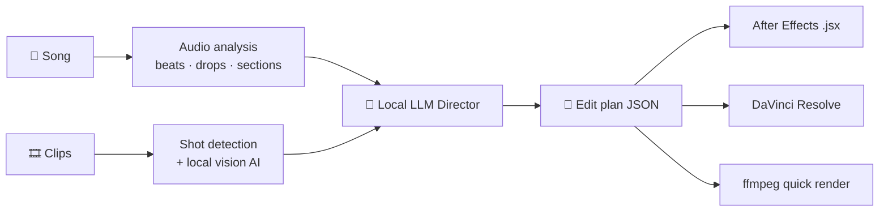

<h1 align="center">🎬 Kadenz</h1>

<p align="center">
  <b>Drop in clips + a song → get a beat-synced After Effects project.</b><br>
  100% local AI. No cloud. No subscriptions. Fully editable output.
</p>

<p align="center">
  <br>
  <sub><i>(demo GIF coming with v0.1)</i></sub>
</p>

<p align="center">
  
  
  
  
</p>

---

## 🤔 Why Kadenz?

Making a montage, a gaming edit or an esports highlight reel takes **hours** of scrubbing clips and lining up cuts with the beat.

Kadenz does the boring part for you:

1. **Listens** to your song: beats, drops, build-ups, quiet parts
2. **Watches** your clips: finds the best shots, action moments and calm moments
3. **Plans** the edit with a local AI that matches the right shot to the right moment
4. **Builds** a real After Effects project with cuts, transitions, shakes, flashes and speed ramps, all on the beat

You get a **normal, fully editable AE project**, not a flat video. Tweak anything, then render.

## ✨ Features

| | Feature | Status |
|---|---|---|
| 🥁 | Beat, drop and section detection | 🛠️ v0.1 |
| ✂️ | Automatic shot detection in your clips | 🛠️ v0.1 |
| 🎯 | Cut-on-beat placement | 🛠️ v0.1 |
| 📜 | After Effects `.jsx` export (one click to build the comp) | 🛠️ v0.1 |
| 🧠 | Local vision AI that tags shots (action, calm, hype, highlight) | 📅 v0.2 |
| 🤖 | Local LLM "director" that plans the whole edit | 📅 v0.2 |
| 💥 | Beat-synced effects: shake, flash, zoom punch, speed ramp | 📅 v0.2 |
| 🎨 | Edit style presets: *Velocity*, *Cinematic*, *Esports Montage*, *Chill* | 📅 v0.3 |
| 🎞️ | DaVinci Resolve and `ffmpeg` export (no AE required) | 📅 v0.3 |
| 🖥️ | Desktop app with drag & drop | 📅 v0.4 |

## ⚙️ How it works



The AI **never edits pixels**. It writes an **edit plan** (a simple JSON file), and your editing software does the real work. That keeps the output editable, high quality and fast.

👉 Read the full idea and architecture in [`docs/IDEA.md`](docs/IDEA.md).

## 🚀 Quick start *(planned for v0.1)*

```bash
git clone https://github.com/Abdullahpronet/Kadenz.git
cd Kadenz
pip install -e .

kadenz --clips ./my_clips --song ./track.mp3 --style velocity --out edit.jsx
```

Then in After Effects: **File → Scripts → Run Script File… → `edit.jsx`** ✅

## 🧩 Requirements

- Python 3.10+
- Adobe After Effects 2022+ for the `.jsx` export
- Optional: a GPU for faster local AI (runs on CPU too)
- Optional: [Ollama](https://ollama.com) or llama.cpp for the LLM director

## 🗺️ Roadmap

- [ ] **v0.1 (Cut on beat):** audio analysis, shot detection, `.jsx` export
- [ ] **v0.2 (Smart edit):** vision tagging, LLM director, beat effects
- [ ] **v0.3 (Styles):** style presets, Resolve and ffmpeg exporters
- [ ] **v0.4 (App):** desktop GUI with drag & drop and preview

## 🤝 Contributing

Kadenz is in early development. This is the best time to shape it!
See [`CONTRIBUTING.md`](CONTRIBUTING.md). Ideas, issues and PRs are welcome.

## ⭐ Support

If you like the idea, **star the repo**. It helps more editors find it.

## 📄 License

[MIT](LICENSE) © Kadenz contributors
